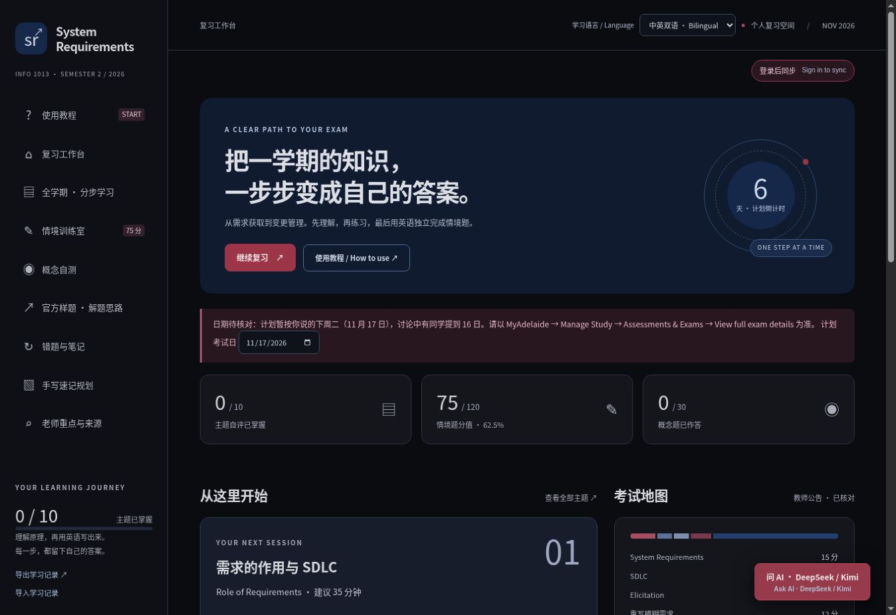
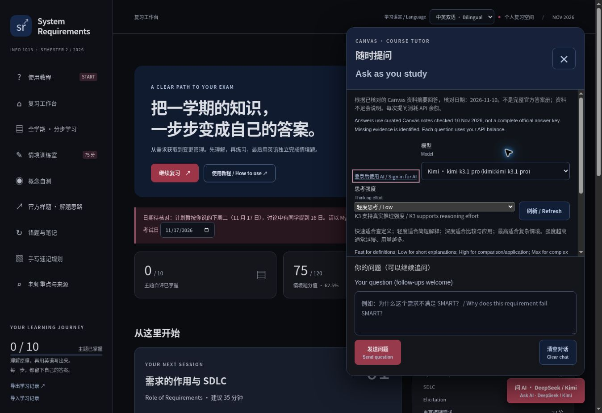

# System Requirements Study Workspace

A personal study web app that turns a semester of system requirements concepts into guided revision, independent practice and source-linked AI feedback.

**HTML · CSS · JavaScript · Node.js · Cloudflare Workers · SQLite / D1**

[Live website](https://system-requirements-study-xianyu.lucky-aphid-5599.chatgpt.site/) · [中文说明](README.zh-CN.md) · [Architecture](docs/ARCHITECTURE.md) · [Development notes](docs/DEVELOPMENT.md)

> **Status:** working student prototype. Built for actual exam revision and improved through use. The personal hosted instance requires its owner's ChatGPT sign-in for paid AI features; opening the public page does not grant access to API credits.



## Why this project?

I wanted a revision tool that helped me move from understanding a concept in Chinese to answering an unfamiliar scenario in English. The project grew through practical requests: bilingual explanations, a darker interface, AI answer checking, a tutor available on every page and progress that follows me between devices.

It also became a practical requirements-engineering exercise: identify a real need, express the expected behaviour, consider failure cases, implement a change and check the result.

## Features

| Area | What it does |
| --- | --- |
| Guided revision | Ten course topics organised into concept, example, application and independent-answer steps. |
| Bilingual learning | Chinese/English study units with bilingual, Chinese-only and English-only display modes. |
| Practice | Thirty original multiple-choice questions, three scenario practice groups, notes and handwritten-sheet planning. |
| Drawing | A locally saved activity-diagram board with pen, eraser, undo and clear. AI grading receives text notes, not drawing pixels. |
| AI answer checks | Server-owned task context and checklists; bilingual feedback without inventing an official exam mark. |
| Floating tutor | Follow-up questions from any page, with links to the curated Canvas evidence. |
| Provider choice | DeepSeek and Kimi model discovery, with controls limited to the thinking settings each supported model accepts. |
| Progress sync | Local-first saving, per-user cloud records, three-way merging, conflict backups and offline recovery. |
| Data portability | Optional JSON import/export for additional backups; daily device changes use cloud sync. |



## Run locally

Use **Node.js 24 or newer**. The project has no third-party npm dependencies.

```bash
git clone https://github.com/XianyuHu227/System-requirements-study-workspace.git
cd system-requirements-study-workspace
npm run build
npm run dev
```

Open the URL printed by the preview server (normally `http://0.0.0.0:5173`; use `http://localhost:5173` in your browser).

The local preview provides the full study UI and a SQLite-backed sync simulation using a fixed development identity. It intentionally does **not** load API keys or provide real ChatGPT authentication. Local AI model discovery therefore reports unavailable until a suitable server integration is configured. This preview identity is confined to `scripts/preview.mjs`, never embedded in the production Worker.

```bash
npm test
```

Tests use mocked AI providers and temporary SQLite data. They do not call paid APIs or need real credentials.

## Hosted deployment

The current production target is **ChatGPT Sites with a Cloudflare Worker and D1**. This repository is a clean source snapshot, not a reusable credential for the author's deployment.

1. Register your own Site and place its project ID in `.openai/hosting.json`, retaining `"d1": "DB"`.
2. Configure `DEEPSEEK_API_KEY`, `KIMI_API_KEY` and `AI_OWNER_EMAIL` as **server-side secrets**. Variable names are documented in `.env.example`; no real values are included.
3. Run `npm run build` and `npm test`.
4. Publish the generated Worker with the Sites source/build workflow. The SQL migration under `drizzle/` creates the D1 progress tables.
5. Verify sign-in and the paid-AI owner check before using the hosted instance.

The production code trusts identity headers supplied by Sites dispatch. Deploying the Worker on another host requires implementing an equivalent trusted authentication layer; exposing it with client-controlled identity headers is unsafe. GitHub Pages alone cannot run the backend, hold API secrets or provide the cloud database.

## Project structure

| Path | Purpose |
| --- | --- |
| `public/` | Browser UI, study content, bilingual text, AI controls and sync client. |
| `worker/index.js` | API validation, AI provider routing, grounding and static asset delivery. |
| `worker/kimi.js` | Verified Kimi model capabilities and provider-specific parameter mapping. |
| `worker/progress.js` | Authenticated D1 progress reads and revision-checked writes. |
| `knowledge/official-course.json` | Curated paraphrases and provenance links for the course evidence. |
| `drizzle/` | Initial SQL migration and migration journal. |
| `scripts/` | Build, local preview and automated verification. |
| `.openai/hosting.json` | Portable D1 binding declaration; supply your own Site ID when deploying. |
| `docs/` | Architecture, development context and screenshots. |

## How AI grounding works

The server sends the selected provider the canonical practice task or question and the curated course evidence. The response must match a structured bilingual schema. Q&A citations are checked against known source IDs; URLs are assembled by the server rather than accepted from model output.

The corpus consists of **paraphrases checked on 10 November 2026**, not full original lecture pages, a complete official answer key or a live Canvas connection. Practice answers and checklists are study aids. The tutor distinguishes course explanations, practice applications and insufficient evidence. Valid source IDs help trace an answer but cannot guarantee that every generated claim is correct.

Course links may require university access. No original lecture slide decks, downloaded exam PDFs, private discussion exports, personal learning records or cloud database files are distributed in this repository.

## Sync behaviour

Edits save to the browser immediately and are queued for sync after about one second. Open devices check about every fifteen seconds and on returning to the page. Revision compare-and-swap prevents a stale device from blindly replacing cloud state; field-level merging preserves unrelated edits.

Conflicting answer/drawing versions are recoverable from the sync panel (up to forty entries). The latest twenty tutor exchanges travel with the study record. The backend also retains ten recent committed snapshots per user for operational recovery. Wait for **Cloud synced** before leaving a device; a closed offline device cannot upload until it is opened again.

## Verification and limitations

The automated suite checks provider routing and thinking settings, malformed responses, citation validation, input/origin limits, owner-only paid API access, bilingual coverage, quiz correction and multi-device sync scenarios. Sync tests use actual in-memory SQLite, including concurrent writes, offline reloads, deletions, conflict restoration and lost acknowledgements.

The prototype still has limits: AI responses can be wrong or fail schema validation; the evidence needs manual updates; drawings are not visually graded; per-isolate AI rate limits are best-effort rather than a durable account-wide quota; and a full accessibility/cross-browser audit remains future work.

## Development and attribution

Created by **Xianyu Hu** as a personal learning project. Development was substantially assisted by **ChatGPT/Codex**, including generated and revised application code, documentation and tests. Requirements and revisions grew out of the author's study needs and feedback. This repository is not a claim that every line was written manually.

The project is independent of the university and course teaching team. Course-linked study summaries are included for educational context and are not official teaching materials or official marking guidance. Application code is available under the [MIT License](LICENSE). Linked university and third-party materials retain their original rights.
