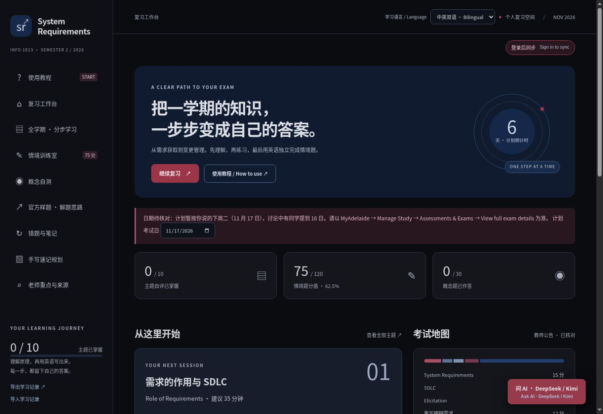

# System Requirements 双语复习工作台

一个为了自己的期末复习而开发的网站：分步理解知识、独立作答、查看有来源的 AI 反馈，并在不同设备继续学习。

[English README](README.md) · [在线版](https://system-requirements-study-xianyu.lucky-aphid-5599.chatgpt.site/) · [架构说明](docs/ARCHITECTURE.md) · [五十题覆盖与依据](docs/PRACTICE.md)



## 目前支持

- 十个主题的分步学习，每个主题五道主观练习，共五十题；中英双语、仅中文、仅英文显示。
- 三十道自编概念题、三组情境练习、错题与笔记、手写速记规划。
- 活动图画板：画笔、橡皮、撤销和清空；可把画板一键发给视觉模型分析 UML 图。
- DeepSeek / Kimi 答案检查与全站浮动问答；支持视觉的模型可上传/粘贴图片分析 UML 图，模型和思考设置按实际支持情况显示。
- 浏览器即时保存、账号云端同步、离线重试和同题冲突备份。
- JSON 导出/导入作为额外备份方式。

## 本地运行

需要 Node.js 24+，不需要安装第三方 npm 依赖。

```bash
git clone https://github.com/XianyuHu227/System-requirements-study-workspace.git
cd system-requirements-study-workspace
npm run build
npm run dev
```

打开终端打印的地址，通常在浏览器访问 `http://localhost:5173`。

本地预览使用固定的**开发测试身份**和本地 SQLite 模拟同步，不接入真实 ChatGPT 登录，也不会加载 API 密钥。因此本地默认可以体验复习与同步界面，AI 模型列表会显示不可用。生产部署需要单独配置认证、数据库及服务端密钥，具体步骤见英文 README。

```bash
npm test
```

测试使用模拟 AI 响应和临时 SQLite，不消耗真实 API 额度。

## 工程组成

| 技术 | 用途 |
| --- | --- |
| HTML / CSS | 页面结构、暗色主题、响应式布局 |
| JavaScript | 页面交互、同步客户端、AI 后端和验证逻辑 |
| Node.js | 构建、本地预览、自动化测试 |
| Cloudflare Workers | 已部署版本的后端运行环境 |
| SQLite / Cloudflare D1 | 本地同步模拟及云端学习记录 |

所有真实 API 密钥都保存在托管服务器的机密配置中。仓库仅提供空的配置示例，不包含用户答案、云端数据库、原始课件或私密讨论导出。

AI 使用的是 2026-11-10 核对的课程资料**摘要与来源链接**，不实时读取 Canvas，也不等于老师的完整答案册。自编题目、参考答案和检查项均为复习辅助，回答仍需对照课程原文。

图片分析仅支持视觉模型（DeepSeek Flash、Kimi K3 / K2.6 / moonshot-v1-*-vision-preview），支持 PNG / JPEG / WebP / GIF。图片只随当前问题发送，不会存入同步记录或云端；手写图可能被误读，结果仅供复习参考。

## 开发背景

这是一个仍有待打磨的学生项目。需求来自真实使用：先做双语分步复习，再改善配色、加入 AI 批改、支持多模型，最后解决跨设备导入 JSON 太麻烦的问题。

项目由 Xianyu Hu 提出学习目标与改进需求，并大量使用 ChatGPT/Codex 协助生成和修改代码、文档与测试。它记录的是一次 AI 辅助开发和需求迭代过程，并不宣称所有代码均为手工独立编写。

应用代码采用 [MIT License](LICENSE)。链接中的学校与第三方资料保留原有权利；此仓库不代表学校或教师的官方产品。
