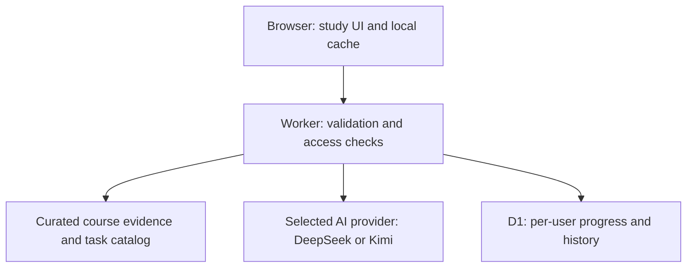

# Architecture

## Runtime boundaries

The build embeds public assets, the canonical task catalog and the curated evidence into a single Worker ES module. Credentials are read only from runtime environment bindings; they are not part of that bundle.

| API | Access | Purpose |
| --- | --- | --- |
| `GET /api/models` | Model metadata is public | Discover configured providers and supported model controls. Provider failures are isolated. |
| `POST /api/grade` | Sites-authenticated owner email | Grade a known task using server-owned context and study checklists. |
| `POST /api/ask` | Sites-authenticated owner email | Ground a bilingual explanation in the supplied curated evidence. |
| `GET /api/progress` | Sites-authenticated user ID | Read only the current user's revision and document. |
| `PUT /api/progress` | Sites-authenticated user ID | Validate the document and save only if its expected revision matches. |

`AI_OWNER_EMAIL`, `DEEPSEEK_API_KEY` and `KIMI_API_KEY` are server-side secrets. Account IDs and email addresses are taken from the trusted host's identity headers, not from request JSON. Production deployments on another platform must replace this trust boundary with a real authentication adapter.

## AI path

1. The browser submits a selected model ID, supported effort and current question/answer.
2. The Worker checks origin, size, identity, model discovery results and input schema.
3. The Worker adds canonical task/evidence context and selects a fixed provider endpoint.
4. The provider returns structured JSON. Hidden reasoning is not displayed or saved as learning content.
5. The Worker validates bilingual fields and, for Q&A, known source IDs. It attaches canonical source links.
6. The browser escapes model text, renders the feedback and saves it with the learning record.

DeepSeek effort values are read from its model metadata. Verified Kimi K3 models use `reasoning_effort` with Low/High/Max and always think. Supported K2 variants have a thinking switch or fixed thinking mode. Output limits are bounded separately from reasoning effort; increasing an output cap is not presented as a new model capability.

The evidence is a small manually maintained corpus, so the whole curated corpus is included in Q&A requests. This is not vector retrieval, fine-tuning or automatic Canvas ingestion.

## Sync path

The browser keeps an acknowledged cloud base and current local state. A sync reads the current remote version, performs a three-way field-level merge, then writes using revision compare-and-swap. A rejected stale write is merged and retried.

Different question fields merge independently. Concurrent non-empty chat histories are unioned. Conflicting drafts, drawings or AI feedback preserve an alternate version in the sync panel. Explicit clears/deletions are compared with the acknowledged base so old devices do not simply restore removed data.

D1 writes and history updates are batched. The current document is isolated by authenticated user ID. Cached metadata detects an account change and pauses sync to avoid mixing one account's local work into another's cloud record.

## Limits

- Maximum request/document size for sync: approximately 2.5 MB.
- Drawing limit: 150,000 points.
- User-visible conflict backups: up to 40.
- Synced tutor exchanges: latest 20; only the most recent two are sent as conversational context.
- Operational D1 snapshots: latest 10 per user.
- AI request budget: best-effort per-isolate limit, not a globally durable quota.

See source validation for the exact contracts. Production response correctness still requires checking the linked course material.
